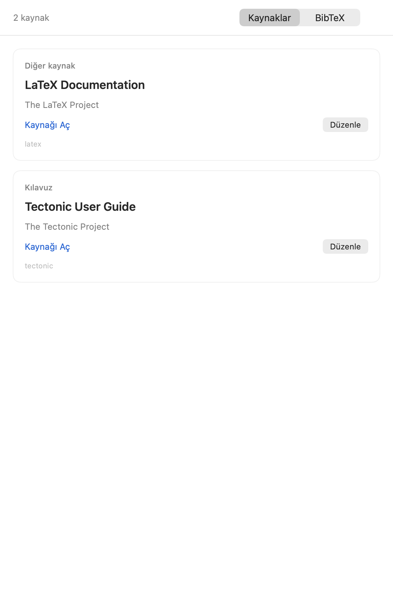
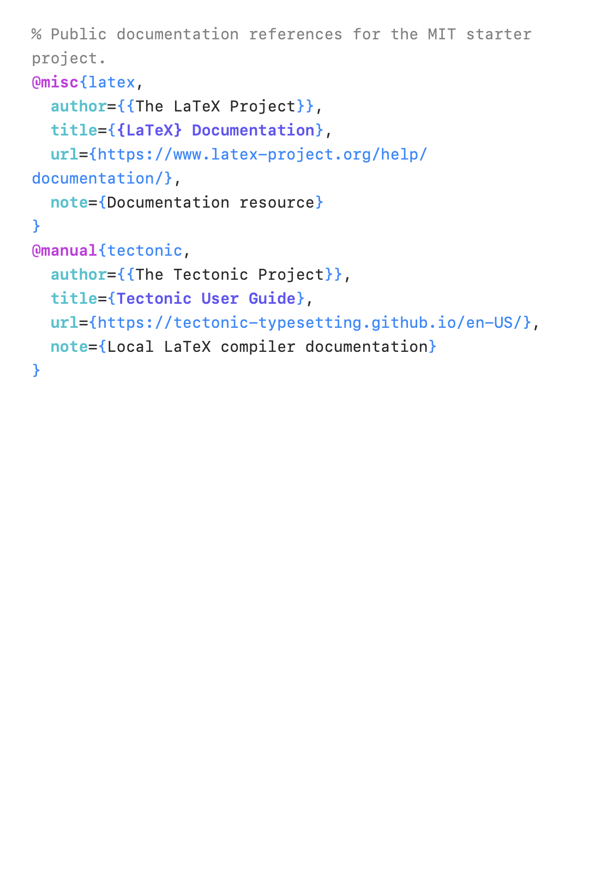
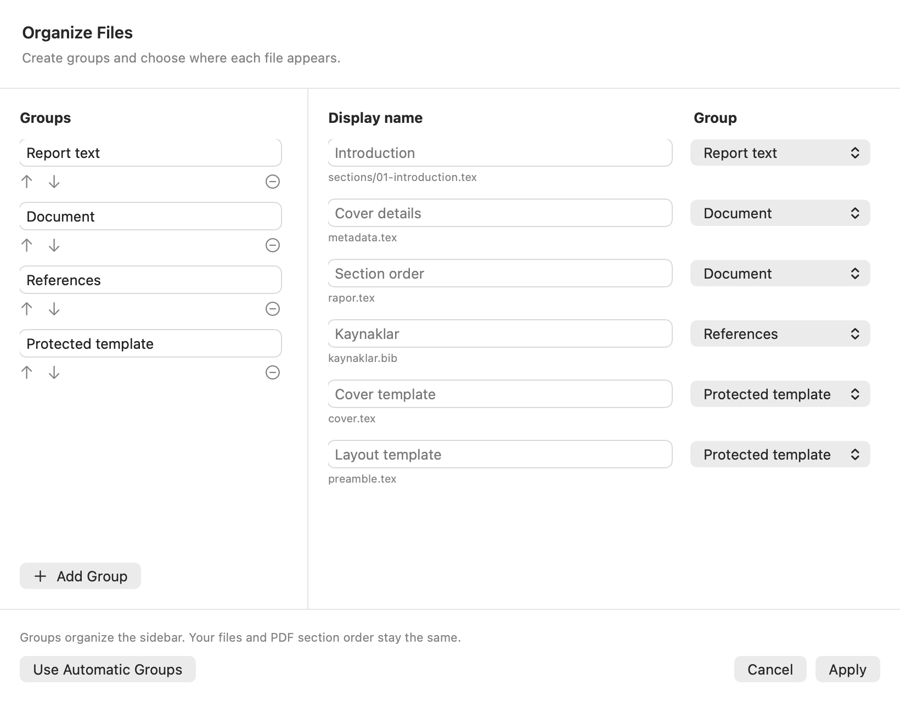

# OpenTeX

A small native macOS LaTeX editor and workspace for local LaTeX reports: files on the left, source in the middle, and a compiled PDF on the right. Built with SwiftUI, AppKit and PDFKit, without a web server or external application framework. The interface follows your primary macOS language: Turkish and English are supported, with English used for any other language. Report text and bibliography content are never translated. Restart the app after changing the macOS language.

Previously named **Rapor**. Repository: [AhmetNA/OpenTeX](https://github.com/AhmetNA/OpenTeX).

## Features

- Edit the original `.tex` and `.bib` files, with syntax highlighting, autosave and undo.
- Compile locally and keep the previous successful PDF when compilation fails.
- Distinguish BibTeX record types, keys, field names, titles, dates and links with semantic syntax colours and font weights.
- Browse references as readable records, edit literal fields in a form, or switch to raw BibTeX. Unknown fields, comments and directives are preserved; macro expressions remain available in raw mode.
- Select text in either the source editor or PDF to reveal the matching location on the other side. Editor selections scroll to and highlight the PDF while preserving keyboard focus; cover fields prefer editable metadata/the cover page. This uses text/context matching, not SyncTeX; ambiguous text, equations, generated labels and text absent from the current PDF may not resolve. Long source selections reveal their opening passage.
- Search filenames and content with Turkish/case normalisation and limited typo tolerance.
- Organize files into your own named groups, change their order and set optional display names. New files are discovered automatically; section labels come from LaTeX headings or filenames.
- Hide the file sidebar, resize panes, zoom the PDF and export it.
- Detect external source changes and protect conflicting unsaved drafts.





## Requirements

- macOS 14 or later; build for the current Mac architecture.
- Xcode Command Line Tools (`xcode-select --install`).
- [Tectonic](https://tectonic-typesetting.github.io/) for local PDF compilation (`brew install tectonic`).
- A stable Apple Development or Developer ID Application signing identity is recommended.

## Build and run

```sh
./build.sh
open dist/OpenTeX.app
```

The build selects an available Apple Development/Developer ID Application identity. You can pin one with `OPENTEX_SIGNING_IDENTITY`. Consistent signing allows macOS to recognise updates as the same application and retain file-access consent. The first access, or migration from an ad-hoc build, can still require one macOS approval. The app does not bypass privacy controls.

If you have no signing identity, an explicit local-only build is available:

```sh
OPENTEX_ALLOW_ADHOC=1 ./build.sh
```

Ad-hoc builds may ask for file access again after updates. Builds are not notarized or App Store distributions. No signing certificates or private keys are included.

The app initially opens `examples/starter`. To use your own project, choose **Open Project** (**Proje Aç** in Turkish) or launch with:

```sh
open -n dist/OpenTeX.app --args --project /path/to/project --file kaynaklar.bib
```

## Project layout

```text
project/
  report/
    rapor.tex
    metadata.tex
    kaynaklar.bib
    sections/
  scripts/
    build_report.py
  output/pdf/
    bitirme-raporu.pdf
```

`report/rapor.tex` is the entry point. The app runs `scripts/build_report.py` from the project root and previews `output/pdf/bitirme-raporu.pdf`; this filename is a current project convention. Use the included MIT-licensed starter as a template. Its example compilation script preserves the last PDF on failure. `cover.tex` and `preamble.tex` are read-only in the editor; modify your own template files outside the app as needed. `report/build` and `report/template-original` are excluded from the working file list.

Files are local. There is no application account, hosted compiler, telemetry or built-in AI service. Tectonic may download TeX packages on its first compilation. DOI/source links open in your default browser only when clicked.

## Organize your project

Click the sliders button beside **OpenTeX** in the sidebar, or choose **View → Organize Files…**. Add, rename, reorder or remove groups; use each file’s group picker to assign it. Leave a display name empty to use the first `\chapter` / `\section` heading, or the filename if no heading is available. Removing a group keeps its files under **Ungrouped**. **Use Automatic Groups** restores groups inferred from folders and file types; **Cancel** discards changes in the dialog.

The layout is stored in `.opentex/workspace.json` in the selected project, and travels with that project. It affects the sidebar only: source paths and the `\input` order in `report/rapor.tex` stay unchanged. User-written group/display names are kept as entered; automatically generated interface labels follow the system language. New files join a matching automatic group when available, otherwise **Ungrouped**. An unreadable layout or another editor’s concurrent changes are preserved instead of overwritten.



## Keyboard shortcuts

| Action | Shortcut |
| --- | --- |
| Save | Command-S |
| Compile | Command-R |
| Export PDF | Command-Shift-E |
| Open project | Command-O |
| Toggle file sidebar | Control-Command-S |
| Next / previous search match | Command-G / Shift-Command-G |

## Checks

```sh
./Tests/run.sh
python3 examples/starter/scripts/build_report.py
```

Checks cover system-language selection, both translation catalogs and English fallback, editable project layouts and live file discovery, source search, reverse PDF navigation, bibliography parsing and field-preserving edits, native PDFKit callbacks in both directions, selection-loop suppression and editor focus, autosave and conflicting drafts. They use temporary projects. The starter compile is an additional local integration check.

## Scope and licence

OpenTeX's source, application icon and original starter files are distributed under the [MIT License](LICENSE). User documents, institutional templates and third-party research datasets are not included. Apple system frameworks and Tectonic remain subject to their own licences; they are not bundled in this repository.
